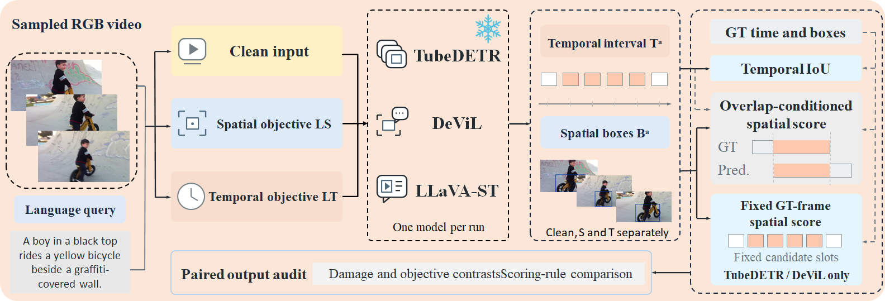
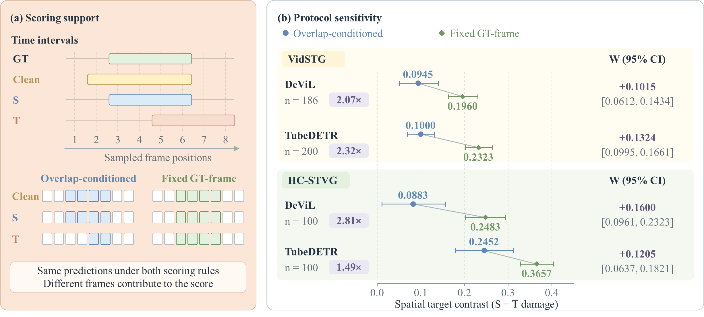

<div align="center">
  <h1>STVG Protocol Toolkit</h1>
  <p><b>Paired Audits of Scoring Protocols in Spatio-Temporal Video Grounding</b></p>
  <p>
    A CPU toolkit for auditing how scoring protocols affect measured attack selectivity
    in spatio-temporal video grounding. It recomputes paired protocol comparisons,
    mechanism contributions, query-level ranking changes, and clustered confidence
    intervals from frozen prediction evidence.
  </p>
  <p>
    <a href="#overview">Overview</a> ·
    <a href="#key-results">Key Results</a> ·
    <a href="#quick-start">Quick Start</a> ·
    <a href="#reproducibility">Reproducibility</a>
  </p>
  <p>
    
    
    
    
    
  </p>
</div>

## Highlights

- Compares **overlap-conditioned** and **fixed GT-frame** scoring on the **same frozen predictions**
- On VidSTG, fixed-GT target contrasts reach **2.07–2.32×** the overlap-conditioned contrasts; across four evaluations, **9.0%–36.0%** of queries show **strict query-level ranking flips**
- Supports CPU recomputation, mechanism decomposition (A/B/C), source-video clustered CIs, and automated validation

## Overview

<p align="center">
  
</p>
<p align="center"><em>Figure 1. Frozen model predictions are scored under a shared sampling map; overlap-conditioned and fixed GT-frame protocols are compared as a paired audit.</em></p>

The toolkit does **not** run models, load weights, or read raw videos. All headline numbers below use the **frozen scoring** definition in `stvg_protocol_toolkit/config/stat_config.json`.

## Key Results

<p align="center">
  
</p>
<p align="center"><em>Figure 2. Same predictions, different scoring support: fixed GT-frame scoring increases measured spatial target contrast relative to overlap-conditioned scoring.</em></p>

Frozen paired protocol effect $W=\mathrm{mean}(d_{\mathrm{GT}}-d_{\mathrm{ov}})$, with $d=s_T-s_S$. Values below are recomputed from archived boxes and temporal intervals.

| Dataset | Model | Common Queries | W (95% CI) | Strict Rank Flips |
|---|---|---:|---|---|
| VidSTG | TubeDETR | 200 | 0.1324 (0.0995, 0.1661) | 18/200 (9.0%) |
| VidSTG | DeViL | 186 | 0.1015 (0.0612, 0.1434) | 40/186 (21.5%) |
| HC-STVG | TubeDETR | 100 | 0.1205 (0.0637, 0.1821) | 26/100 (26.0%) |
| HC-STVG | DeViL | 100 | 0.1600 (0.0961, 0.2320) | 36/100 (36.0%) |

On VidSTG, the fixed-GT spatial target contrast is **2.07×** (DeViL) to **2.32×** (TubeDETR) the overlap-conditioned contrast. Strict ranking flips are counted at the **query** level.

## Quick Start

Runnable package root: `stvg_protocol_toolkit/`.

```bash
cd stvg_protocol_toolkit
python -m pip install -r requirements.txt

python audit_protocol.py \
  --input data/raw_predictions.jsonl \
  --config config/stat_config.json \
  --out outputs/

python scripts/validate_outputs.py
python stvg_protocol_toolkit/tests/test_edge_cases.py
```

This release recomputes **scores and statistics from frozen predictions**. It does not reproduce GPU model inference.

## Inputs and Outputs

| Role | Path | What it contains |
|---|---|---|
| Input | `stvg_protocol_toolkit/data/raw_predictions.jsonl` | Prediction boxes, temporal intervals, GT, sampling maps |
| Summary | `stvg_protocol_toolkit/outputs/frozen_protocol_summary.csv` | Dual-protocol group aggregates and CIs |
| Per-query | `stvg_protocol_toolkit/outputs/frozen_per_query.csv` | Per-query frozen scores |
| Mechanisms | `stvg_protocol_toolkit/outputs/decomposition_*.csv` | Signed A/B/C contributions |
| Ranking | `stvg_protocol_toolkit/outputs/ranking_*.csv` | Query-level strict flips / tie changes |
| Regen | `stvg_protocol_toolkit/outputs/regeneration_*.csv` | DeViL-32 frozen regeneration comparison |
| Exclusions / gaps | `exclusion_no_gt_candidates.csv`, `gaps.json` | Excluded queries; scoring gaps (must be empty) |

<details>
<summary><b>Field notes, scoring definition, and mechanism labels</b></summary>

<br>

**Input fields used for recomputation** (`data/raw_predictions.jsonl`, one JSON object per line):

- Identifiers: `group`, `dataset`, `model`, `sample_id`, `video_id`, `source_video_id`, `cluster_id`, `round`
- Exclusion: `exclusion_reason` (`no_gt_candidate_slots` for 14 DeViL queries; **not** mechanism class A)
- `arms.Clean|S|T`: `pred_temporal_frames`, `pred_time_sec`, `gt_temporal`, `pair_rows[]` (`abs_frame_id`, `gt_box_xywh`, `pred_box_xywh`), `sampling`, `evidence_sha256`, `score_version`
- Optional provenance: `orig_*` / `orig_record_scores` (original-run scores; **not** used for frozen recomputation)

**Frozen W** (see `config/stat_config.json`):

`W = mean(d_GT − d_ov)` with `d = s_T − s_S`, `g = s_GT − s_ov`, `w = g_T − g_S`.

Bootstrap: B=10000, seed=20261008; VidSTG clusters by `video_id`, HC-STVG by `source_video_id`; ranking ε=1e-8.

**Mechanism labels**

- **A**: empty GT∩pred temporal intersection → overlap contribution zeroed
- **B**: nonempty time intersection but no sampled support in the intersection
- **C / C_full**: nonempty selected frames (both roll into aggregate C)
- **M**: sampled support present but no valid box pair → gap (not counted as A/B)
- **`exclusion_reason=no_gt_candidate_slots`**: query-level exclusion (DeViL 14); do not conflate with A

**Frozen vs original-run scores**

- Frozen scores are recomputed here from boxes + temporal intervals with `explicit_gt_interval_v1`
- Original-run scores (`orig_*`) are retained for provenance only

</details>

## Reproducibility

Verified on a clean checkout of this package:

| Check | Result |
|---|---|
| Statistical acceptance (`scripts/validate_outputs.py`) | **116/116** |
| Known-output controls (`tests/test_edge_cases.py`) | **9/9** |
| Independent directory recomputation | Pass |
| Common queries | 200 / 186 / 100 / 100 |
| Strict query-level flips | 18/200, 40/186, 26/100, 36/100 |
| Scoring gaps (`outputs/gaps.json`) | **0** |

**Evidence scope.** DeViL original overlap full boxes were **not archived**. Frozen diagnostics in this toolkit use the **fixed-chain boxes** present in `pair_rows`. Regeneration (32-query) comparisons are likewise frozen-chain recomputations of archived rounds. This is distinct from any original-run scorer that consumed unrecovered overlap boxes.

Package-local technical README: [`stvg_protocol_toolkit/README.md`](stvg_protocol_toolkit/README.md).

## License and Acknowledgments

- Toolkit code: [MIT](stvg_protocol_toolkit/LICENSE)
- Third-party notices: [`stvg_protocol_toolkit/THIRD_PARTY_NOTICES.md`](stvg_protocol_toolkit/THIRD_PARTY_NOTICES.md)
- Upstream dataset licenses apply to raw videos (videos are **not** included). Model code and weights are **not** included.
